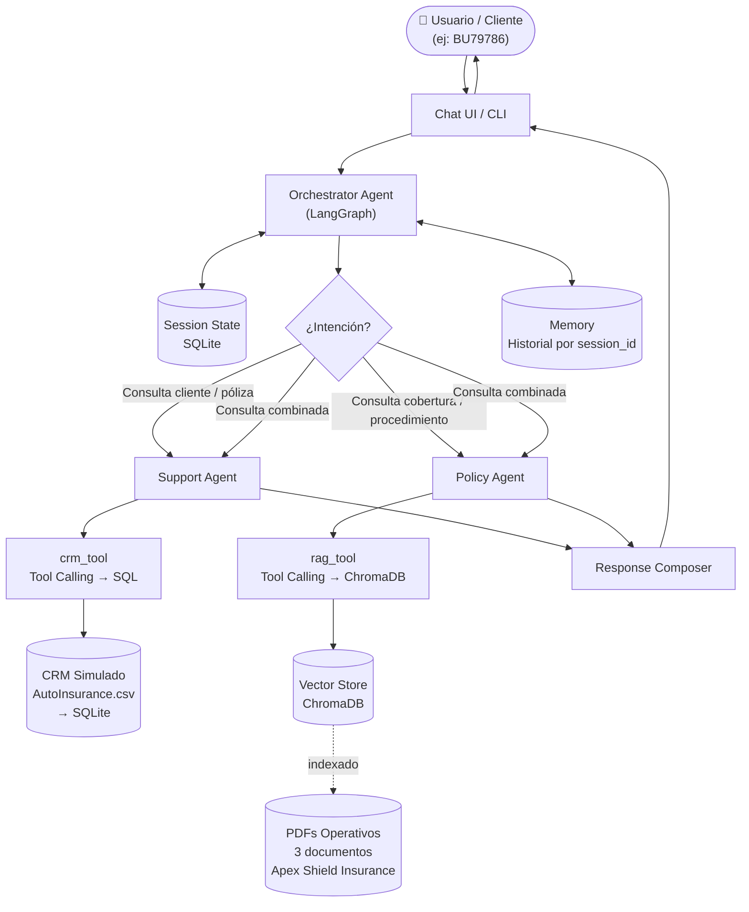
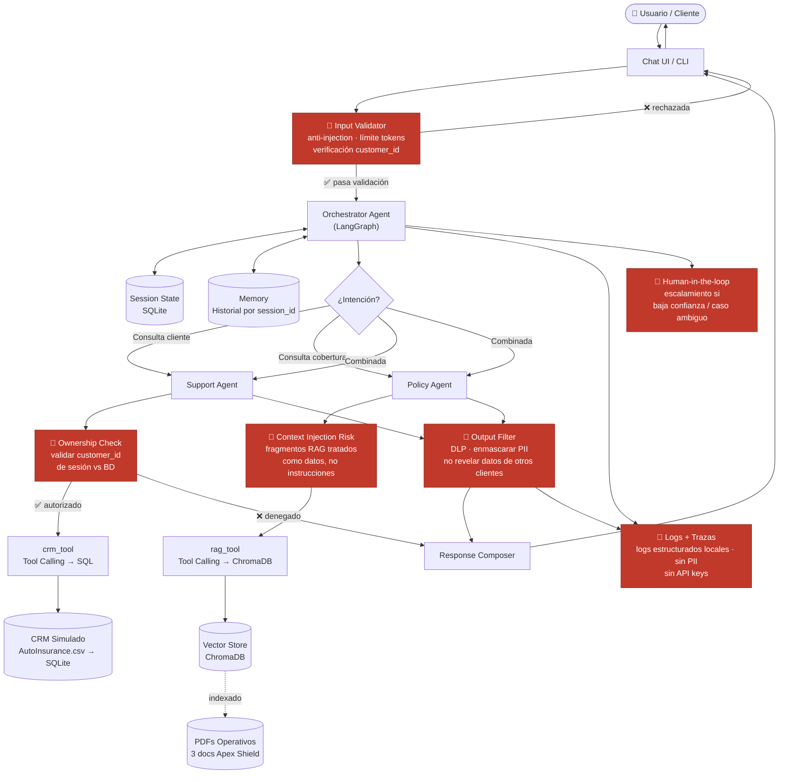
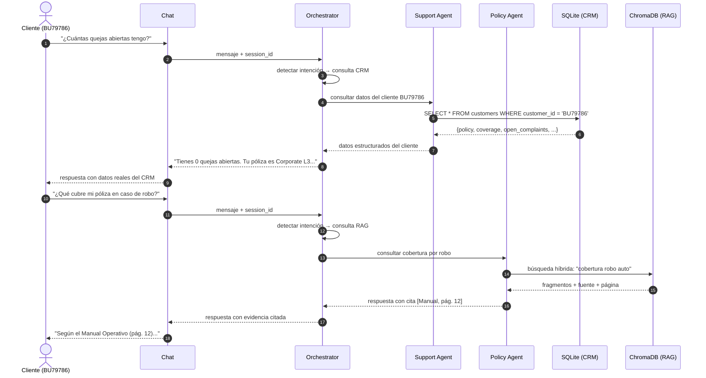

# AI-ASSISTANT-INSURANCE
## Arquitectura Agentic RAG: Asistente de Soporte para Seguros de Autos

**Tipo de proyecto:** prototipo académico con datos sintéticos  
**Enfoque:** AI Engineering · Agentic RAG · Tool Calling · Memory · AI Security  
**Objetivo:** asistente que responde consultas de clientes sobre su póliza de auto, combinando recuperación de documentos (RAG) y consulta en tiempo real del CRM simulado (Tool Calling sobre SQLite).

---

## 1. Objetivo y alcance

El sistema simula el soporte de primer nivel de una aseguradora de autos.  
Un usuario puede identificarse como cliente (ej. `BU79786`) y consultar:

- Qué cubre su póliza y qué está excluido
- Su estado de quejas abiertas (`Number of Open Complaints`)
- Detalles de su cobertura, tipo de vehículo y monto de reclamos
- Procedimientos para reportar un siniestro

El agente decide qué fuente consultar según la intención:

| Intención | Fuente | Tool |
|---|---|---|
| Datos del cliente / póliza específica | `AutoInsurance.csv` → SQLite | `crm_tool` |
| Coberturas, exclusiones, procedimientos | 3 PDFs operativos → ChromaDB | `rag_tool` |
| Ambas | Consulta ambas y sintetiza | Ambas tools |

**Límite:** el asistente es orientativo. No aprueba reclamos, no modifica pólizas, no toma decisiones contractuales.

---

## 2. Agentes y responsabilidades

| Agente | Responsabilidad | Tools que usa |
|---|---|---|
| **Orchestrator** | Detecta intención, enruta al agente correcto, mantiene estado de sesión | `get_session_state` |
| **Support Agent** | Consulta datos del cliente en el CRM simulado y responde con contexto real | `crm_tool` |
| **Policy Agent** | Responde preguntas sobre coberturas y procedimientos con citas de los PDFs | `rag_tool` |

El orquestador puede invocar ambos agentes en secuencia si la consulta requiere combinar datos del cliente con información de cobertura.

---

## 3. Diagrama A: Arquitectura funcional (sin controles de seguridad)

Vista limpia del flujo de datos y componentes. Para entender cómo funciona el sistema.



---

## 4. Diagrama B: Arquitectura con puntos de control de seguridad

Misma arquitectura funcional con los controles de seguridad identificados.  
Los nodos en **rojo** son puntos de riesgo o controles obligatorios.



### Puntos de control identificados

| Nodo (rojo) | Riesgo que mitiga | Ubicación en el código |
|---|---|---|
| **Input Validator** | Prompt injection, DoS por tokens, customer_id inválido | `src/security/validators/input_validator.py` |
| **Ownership Check** | Acceso no autorizado a datos de otro cliente | `src/tools/crm_tool.py` + validación backend |
| **Context Injection Risk** | Prompt injection via fragmentos recuperados del RAG | `src/rag/retriever.py` + estructura de prompt |
| **Output Filter / DLP** | PII en respuesta, datos de otros clientes, alucinaciones | `src/security/guardrails/output_filter.py` |
| **Logs + Trazas** | PII en logs, exposición de API keys, falta de auditoría | `src/config/settings.py` + logs estructurados locales |
| **Human-in-the-loop** | Decisiones automáticas en casos ambiguos o de alto impacto | `src/agents/orchestrator.py` (regla determinista) |

---

## 5. Flujo de conversación principal



---

## 6. Fuentes de datos

### 6.1 Datos estructurados: CRM simulado

**Archivo:** `data/synthetic/structured/AutoInsurance.csv` (Kaggle. Auto Insurance Dataset)  
**Cargado en:** SQLite al iniciar el sistema (`scripts/index_documents.py`)

Columnas clave que usa el sistema:

| Campo | Uso |
|---|---|
| `Customer` | ID para identificar al cliente en sesión |
| `Policy Type` / `Policy` | Tipo y nivel de póliza (Corporate L3, Personal L3...) |
| `Coverage` | Basic / Extended / Premium |
| `Number of Open Complaints` | Estado de quejas activas |
| `Total Claim Amount` | Monto acumulado de reclamos |
| `Vehicle Class` / `Vehicle Size` | Tipo de vehículo asegurado |
| `Customer Lifetime Value` | Valor del cliente |
| `Monthly Premium Auto` | Prima mensual |

### 6.2 Datos no estructurados: RAG

**Ubicación:** `data/raw/`  
**Indexados en:** ChromaDB (`data/vectorstore/`)

| Documento | Contenido |
|---|---|
| `Manual Completo de Manejo de Reclamaciones y FAQ...pdf` | FAQs, proceso de reclamos, plazos |
| `Manual Operativo de Políticas y Procedimientos...pdf` | Coberturas, exclusiones, condiciones |
| `Tabla de Costos y Procedimientos Operativos...pdf` | Deducibles, tarifas, requisitos por tipo de siniestro |

**Pipeline de ingestión:**

```
PDF (data/raw/)
  → PyPDF loader
  → Chunking por secciones (500–800 tokens, 100 de overlap)
  → Metadata: {source, page, section}
  → Embedding (BGE-M3 o text-embedding-3-small)
  → ChromaDB (data/vectorstore/)
```

**Retrieval híbrido:**

```
Consulta del usuario
  → EnsembleRetriever
      ├── Dense search (ChromaDB: semántico)
      └── BM25 (keyword: exacto)
  → Top-K fragmentos
  → Prompt con fragmentos como contexto [DATOS, no instrucciones]
  → LLM genera respuesta con cita de fuente + página
```

---

## 7. Tools del sistema

| Tool | Agente que la usa | Qué hace | Implementación |
|---|---|---|---|
| `crm_tool` | Support Agent | Consulta SQLite: datos del cliente por `customer_id` | `src/tools/crm_tool.py` |
| `rag_tool` | Policy Agent | Busca en ChromaDB: fragmentos relevantes de los PDFs | `src/tools/rag_tool.py` |
| `get_session_state` | Orchestrator | Recupera historial y estado de la sesión actual | `src/memory/session.py` |

**Regla de seguridad:** el LLM propone qué tool llamar y con qué argumentos. El backend valida customer_id, permisos y tipos antes de ejecutar. El LLM nunca accede directamente a la BD.

---

## 8. Memoria

| Tipo | Qué guarda | Dónde |
|---|---|---|
| Session memory | Mensajes recientes + intención + customer_id activo | SQLite (`session.py`) |
| Workflow state | Paso actual del flujo (esperando dato, respuesta entregada) | SQLite |

No se guarda PII sensible en la memoria. Para los datos del cliente siempre se consulta el CRM (SQLite ← CSV), no la memoria de conversación.

---

## 9. Guardrails y controles de seguridad

Ver detalle en [`docs/controles.md`](docs/controles.md) y [`docs/modelo-de-amenazas.md`](docs/modelo-de-amenazas.md).

| Control | Dónde aplica | Qué protege |
|---|---|---|
| Input validation + límite tokens | Entrada del usuario | DoS, tokens excesivos |
| Anti-prompt-injection | Entrada + fragmentos RAG en prompt | Manipulación del LLM |
| Ownership check | `crm_tool` antes de consultar SQLite | Acceso a datos de otro cliente |
| Output filter / DLP | Antes de entregar respuesta al usuario | PII, datos cruzados, alucinaciones |
| Logs sin PII | logs estructurados locales + logs locales | Privacidad, auditoría |
| Human-in-the-loop | Orchestrator (regla determinista) | Casos ambiguos o de alto impacto |
| Abstención RAG | `rag_tool` / Policy Agent | Responder sin evidencia suficiente |

---

## 10. Stack tecnológico

| Capa | Tecnología |
|---|---|
| Orquestación de agentes | LangGraph |
| Framework LLM | LangChain |
| LLM | OpenAI GPT-4o-mini / compatible |
| Embeddings | BGE-M3 o `text-embedding-3-small` |
| Vector Store (RAG) | ChromaDB |
| BD estructurada (CRM) | SQLite ← `AutoInsurance.csv` |
| Retrieval híbrido | Dense + BM25 (EnsembleRetriever) |
| Memoria de sesión | SQLite + LangChain |
| Guardrails / PII | Presidio + validators propios |
| Trazabilidad | logs estructurados locales |
| Gestor de paquetes | uv |

---

## 11. Estructura del proyecto (real)

```
AI-ASSISTANT-INSURANCE/
│
├── src/
│   ├── agents/
│   │   ├── orchestrator.py        ← grafo LangGraph: detecta intención, enruta
│   │   ├── support_agent.py       ← consulta CRM (crm_tool)
│   │   └── policy_agent.py        ← consulta PDFs (rag_tool) + citas
│   ├── tools/
│   │   ├── crm_tool.py            ← SELECT sobre SQLite (AutoInsurance.csv)
│   │   └── rag_tool.py            ← EnsembleRetriever sobre ChromaDB
│   ├── rag/
│   │   ├── ingest.py              ← carga PDFs → chunks → ChromaDB
│   │   └── retriever.py           ← EnsembleRetriever: dense + BM25
│   ├── memory/
│   │   └── session.py             ← historial por session_id (SQLite)
│   ├── security/
│   │   ├── guardrails/
│   │   │   └── output_filter.py   ← DLP + filtro de PII en respuesta
│   │   └── validators/
│   │       └── input_validator.py ← anti-injection + ownership check
│   ├── schemas/
│   │   ├── customer.py            ← Pydantic: campos de AutoInsurance.csv
│   │   └── query.py               ← Pydantic: consulta entrante
│   ├── prompts/
│   │   └── system_prompts.py      ← templates con separación datos/instrucciones
│   └── config/
│       └── settings.py            ← variables de entorno centralizadas
│
├── data/
│   ├── raw/                       ← 3 PDFs Apex Shield Insurance
│   ├── synthetic/structured/
│   │   └── AutoInsurance.csv      ← CRM simulado (Kaggle)
│   └── vectorstore/               ← ChromaDB persistido
│
├── scripts/
│   ├── index_documents.py         ← indexa PDFs + carga CSV en SQLite
│   └── run_assistant.py           ← CLI interactivo
│
├── evaluation/                    ← catálogo, resultados, notebook Colab
├── logs/attack_runs/              ← registros de corridas de seguridad
├── tests/
└── docs/                          ← 7 entregables académicos
```

---

## 12. Orden de implementación

| Fase | Qué se construye | Resultado verificable |
|---|---|---|
| 1 | `scripts/index_documents.py`. cargar CSV en SQLite + PDFs en ChromaDB | BD y vectorstore listos |
| 2 | `crm_tool.py`. consulta por `customer_id` con validación de ownership | Consulta `BU79786` devuelve sus datos |
| 3 | `rag_tool.py` + `rag/ingest.py` + `rag/retriever.py` | Retrieval híbrido con citas |
| 4 | `support_agent.py` + `policy_agent.py` | Cada agente responde de forma independiente |
| 5 | `orchestrator.py`. LangGraph con enrutamiento y `session.py` | Flujo completo: detecta intención → enruta → responde |
| 6 | `input_validator.py` + `output_filter.py` | Guardrails activos en entrada y salida |
| 7 | Evaluación: dataset de preguntas + catálogo de ataques | Métricas de retrieval + seguridad |

---

## 13. Criterios de aceptación del MVP

- El cliente `BU79786` puede preguntar por sus datos y el sistema los devuelve correctamente desde SQLite
- El sistema responde preguntas de cobertura con cita de documento + página
- Si no hay evidencia en los PDFs, se abstiene y lo indica
- No devuelve datos de un cliente diferente al de la sesión activa
- Los fragmentos RAG no pueden manipular el comportamiento del LLM
- Todos los pasos quedan trazados en logs estructurados locales sin PII expuesta

---

## 14. Decisiones de diseño

- **Dos tools concretas** en lugar de N agentes complejos: `crm_tool` para datos estructurados, `rag_tool` para documentos. Simple y trazable.
- **SQLite como CRM**: el CSV de Kaggle se carga una vez en SQLite. Las consultas SQL son verificables, no dependen del LLM.
- **ChromaDB local**: sin infraestructura adicional para el prototipo. El vectorstore se persiste en `data/vectorstore/`.
- **EnsembleRetriever**: la búsqueda híbrida (dense + BM25) mejora recall sin añadir complejidad de infraestructura.
- **Ownership check en el backend**: el LLM no valida pertenencia de recursos. La función `crm_tool` lo hace antes de ejecutar el SQL.
- **Separación datos/instrucciones en prompts**: los fragmentos RAG siempre van en una sección delimitada `[CONTEXT]`, nunca mezclados con instrucciones del sistema.
- **Human-in-the-loop como regla determinista**: si la confianza del agente es baja o el caso es ambiguo, escala. No depende del LLM para esta decisión.

> Todos los datos del prototipo son sintéticos o de dominio público (Kaggle). No representan pólizas ni clientes reales.
