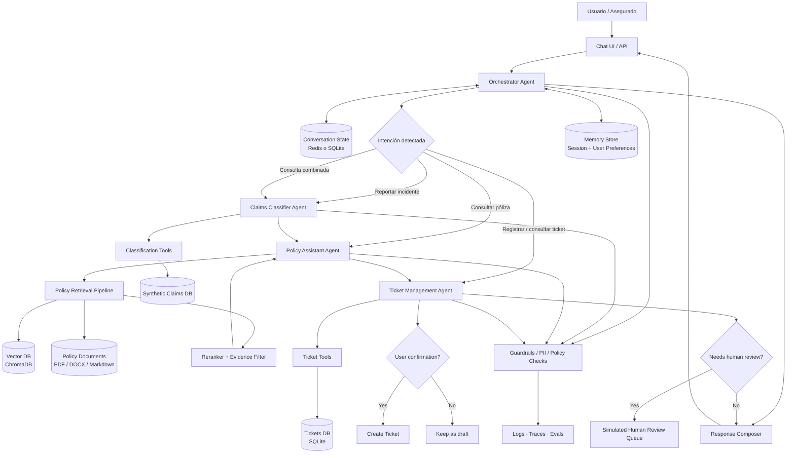
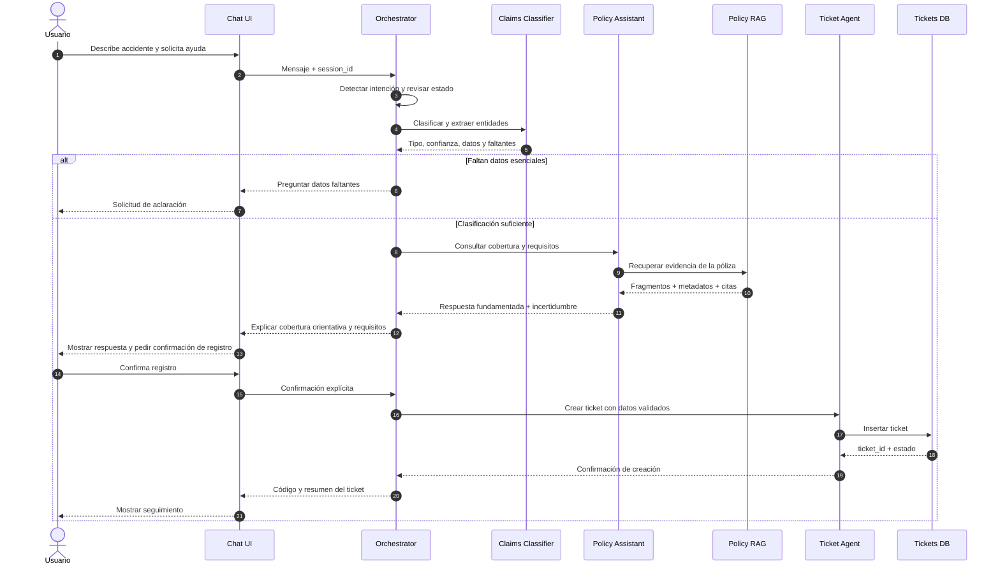
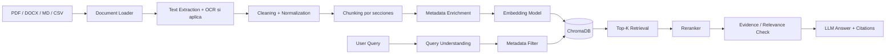

# AI-ASSISTANT-INSURANCE
## Arquitectura de Agentic RAG multiagente para un asistente de reclamos de seguros

**Tipo de proyecto:** simulación funcional con datos sintéticos  
**Enfoque:** AI Engineering · Agentic RAG · Multi-Agent Systems · MCP · Tool Calling · Memory  
**Objetivo:** construir un asistente que clasifique reclamos, responda consultas sobre pólizas y registre tickets de atención.

---

## 1. Objetivo y alcance

El sistema simula el proceso inicial de atención de reclamos de una aseguradora. El usuario puede describir un incidente, preguntar qué cubre su póliza y solicitar que se registre un reclamo.

El asistente debe:

1. Identificar la intención del usuario y recopilar los datos mínimos.
2. Clasificar el reclamo y extraer entidades relevantes.
3. Consultar documentos de póliza y procedimientos mediante RAG.
4. Explicar coberturas, exclusiones y requisitos citando la fuente.
5. Crear un ticket únicamente cuando exista consentimiento y los datos mínimos estén completos.
6. Devolver un identificador y permitir consultar el estado del ticket.

**Límite importante:** el prototipo no determina legalmente la cobertura, no aprueba ni rechaza indemnizaciones, no calcula pagos definitivos y no sustituye la evaluación de un ajustador. Sus respuestas son orientativas y deben escalar los casos ambiguos o sensibles.

---

## 2. Arquitectura propuesta

Se recomienda un **orquestador central con agentes especializados**, no un conjunto de agentes autónomos que conversan sin control. El orquestador enruta cada solicitud, conserva el estado del flujo y valida las acciones antes de ejecutarlas.

### Responsabilidades de los agentes

| Componente | Responsabilidad | ¿Por qué es un agente? |
|---|---|---|
| Orchestrator Agent | Detecta intención, decide qué agente invocar y coordina el flujo. | La solicitud puede necesitar una o varias capacidades en distinto orden. |
| Claims Classifier Agent | Clasifica el siniestro, extrae datos y detecta información faltante. | Requiere interpretar texto libre y producir una salida estructurada. |
| Policy Assistant Agent | Responde preguntas sobre cobertura, exclusiones y requisitos usando RAG. | Debe buscar evidencia, comparar fragmentos y responder con citas. |
| Ticket Management Agent | Valida los datos, solicita confirmación y crea o consulta tickets. | Ejecuta acciones sobre el sistema simulado y controla sus precondiciones. |
| Human Escalation (regla/cola) | Deriva casos complejos, contradictorios o de alto impacto. | No necesita ser un LLM: una política determinista puede gestionar la derivación. |

**Diseño deliberado:** la clasificación y la creación de tickets no necesitan RAG por defecto. Se conectan al RAG de pólizas solo cuando necesitan interpretar requisitos o procedimientos documentados. Esto evita recuperar documentos innecesarios y reduce errores.

---

## 3. Diagrama general de arquitectura



---

## 4. Flujo agentic principal



---

## 5. RAG: fuentes de datos simuladas

### 5.1 Policy RAG — RAG principal

**Propósito:** responder qué cubre una póliza, qué excluye, qué documentos solicita y cuáles son los pasos para reportar un siniestro.

**Documentos sintéticos que debes crear:**

| Fuente | Contenido de ejemplo | Formato |
|---|---|---|
| Póliza de auto | Cobertura por choque, robo, incendio, deducible, exclusiones y límites. | PDF / DOCX |
| Póliza de hogar | Daños por agua, incendio, robo, eventos excluidos y límites. | PDF / DOCX |
| Póliza de salud (opcional) | Beneficios, copagos, carencias, exclusiones y autorizaciones. | PDF / DOCX |
| Manual de reclamos | Pasos para reportar, plazos simulados y canales de atención. | Markdown / PDF |
| Matriz de requisitos | Evidencias requeridas según tipo de siniestro. | CSV / Markdown |
| Glosario | Definiciones de deducible, prima, cobertura, exclusión y siniestro. | Markdown |

**Metadatos recomendados por fragmento:**

```json
{
  "document_id": "AUTO-001",
  "document_type": "policy",
  "product": "auto",
  "policy_version": "2026.1",
  "section": "Exclusiones",
  "page": 8,
  "jurisdiction": "PE",
  "effective_from": "2026-01-01",
  "source": "poliza_auto_demo.pdf"
}
```

Los metadatos permiten filtrar por producto, versión y vigencia antes o durante la recuperación. En un sistema real, la póliza aplicable también debe validarse contra el contrato individual del asegurado; no basta con recuperar una póliza genérica.

### 5.2 ¿Se necesita un segundo RAG?

No es obligatorio para el MVP. Puedes empezar con un único índice vectorial de documentos contractuales y operativos, separado lógicamente mediante metadatos.

Si el proyecto crece, conviene separar:

- **Policy RAG:** condiciones contractuales, coberturas y exclusiones.
- **Claims Procedure RAG:** procedimientos, formularios y evidencias necesarias.

La separación ayuda a controlar permisos, versionado, evaluación y trazabilidad. No crees un RAG independiente para cada agente si todos consultan el mismo conocimiento.

### 5.3 Pipeline de ingestión y recuperación



**Configuración inicial sugerida:**

- Chunking: 500–800 tokens, con 80–120 tokens de solapamiento como punto de partida.
- Respetar encabezados, numeración de cláusulas y tablas; no dividir una exclusión de su contexto.
- Embeddings: modelo multilingüe, por ejemplo BGE-M3 o Qwen3 Embedding.
- Vector DB: ChromaDB para el prototipo local.
- Recuperación: top-k inicial de 5–8 fragmentos, ajustado mediante evaluación.
- Reranking: opcional al inicio; incorporar un reranker multilingüe si la recuperación trae fragmentos poco relevantes.
- Respuesta: incluir nombre del documento, sección y página cuando estén disponibles.
- Abstención: si no hay evidencia suficiente, indicarlo y derivar la consulta.

Los valores son parámetros iniciales de experimentación, no cifras universalmente óptimas.

---

## 6. Datos simulados necesarios

No uses datos personales reales. Genera registros ficticios y marca claramente el entorno como `demo`.

### 6.1 Base de pólizas

Archivo sugerido: `data/synthetic/policies.json`

```json
[
  {
    "policy_id": "POL-AUTO-0001",
    "customer_id": "CUS-0001",
    "product": "auto",
    "plan": "estandar",
    "status": "active",
    "effective_from": "2026-01-01",
    "effective_to": "2026-12-31",
    "vehicle": {
      "make": "MarcaDemo",
      "model": "ModeloX",
      "year": 2022
    },
    "deductible": 500,
    "currency": "PEN"
  }
]
```

### 6.2 Base de reclamos sintéticos

Archivo sugerido: `data/synthetic/claims.json`

```json
[
  {
    "claim_id": "CLM-DEMO-0001",
    "policy_id": "POL-AUTO-0001",
    "incident_type": "collision",
    "description": "Daño en la parte delantera por choque",
    "incident_date": "2026-10-15",
    "location": "Cusco",
    "estimated_damage": 2500,
    "status": "under_review"
  }
]
```

### 6.3 Base de tickets

Archivo sugerido: `data/synthetic/tickets.json`

```json
[
  {
    "ticket_id": "TKT-DEMO-0001",
    "customer_id": "CUS-0001",
    "policy_id": "POL-AUTO-0001",
    "claim_id": "CLM-DEMO-0001",
    "category": "auto_collision",
    "priority": "medium",
    "status": "open",
    "created_at": "2026-10-15T14:30:00-05:00",
    "summary": "Reporte inicial de colisión"
  }
]
```

### 6.4 Catálogo de clasificación

Archivo sugerido: `data/synthetic/claim_categories.json`

Categorías iniciales:

- `auto_collision`
- `auto_theft`
- `auto_glass_damage`
- `home_fire`
- `home_water_damage`
- `home_theft`
- `health_reimbursement` (si incluyes salud)
- `other`
- `uncertain`

Cada categoría debe definir descripción, datos requeridos, prioridad inicial y reglas de escalamiento. La prioridad sugerida por el modelo debe validarse con reglas deterministas.

---

## 7. Tools por agente

Las tools son funciones concretas que el agente puede invocar. No todo debe resolverse con el LLM.

| Agente | Tool | Función | Implementación simulada |
|---|---|---|---|
| Orchestrator | `detect_intent` | Detecta consulta de póliza, nuevo reclamo o seguimiento. | LLM + esquema estructurado |
| Orchestrator | `get_session_state` | Recupera el paso actual del flujo. | SQLite / Redis |
| Classifier | `classify_claim` | Devuelve categoría y confianza. | LLM con JSON Schema |
| Classifier | `extract_claim_entities` | Extrae fecha, lugar, descripción, producto y evidencias. | LLM + validación Pydantic |
| Classifier | `get_required_fields` | Consulta qué campos faltan por categoría. | Python + JSON |
| Classifier | `validate_policy_id` | Verifica existencia y estado de la póliza simulada. | SQLite |
| Policy Assistant | `search_policy_documents` | Recupera fragmentos relevantes. | ChromaDB |
| Policy Assistant | `get_policy_metadata` | Obtiene producto, versión y vigencia. | SQLite / JSON |
| Policy Assistant | `check_evidence_sufficiency` | Comprueba si hay evidencia suficiente para responder. | Reglas + evaluación LLM |
| Ticket Agent | `create_ticket` | Crea un ticket después de validar y confirmar. | SQLite |
| Ticket Agent | `get_ticket_status` | Consulta el estado por ID. | SQLite |
| Ticket Agent | `update_ticket_status` | Cambia estado en entorno demo, con autorización. | SQLite + reglas |
| Ticket Agent | `escalate_to_human` | Envía el caso a una cola simulada. | SQLite |

**Regla de seguridad:** el LLM propone argumentos; el backend valida tipos, permisos, existencia de póliza, campos obligatorios y consentimiento. El LLM nunca escribe directamente en la base de datos.

---

## 8. ¿Se necesita MCP?

**No es obligatorio para construir el MVP.** Puedes implementar las tools como funciones Python y conectarlas al framework de agentes.

MCP resulta útil cuando quieres exponer las capacidades como herramientas estandarizadas, desacopladas del agente y reutilizables por distintos clientes o agentes.

### MCP recomendado para una versión ampliada

| Servidor MCP | Tools expuestas | Recursos |
|---|---|---|
| `policy-mcp` | `search_policy`, `get_policy_details`, `list_policy_versions` | Pólizas y manuales |
| `claims-mcp` | `classify_claim`, `validate_claim_data`, `get_claim_requirements` | Catálogo de siniestros |
| `ticket-mcp` | `create_ticket`, `get_ticket`, `list_tickets`, `escalate_ticket` | Tickets simulados |
| `customer-mcp` (opcional) | `get_customer_demo`, `get_customer_policies` | Clientes ficticios |

**Arquitectura de integración:** los agentes consumen tools MCP mediante un cliente MCP. Cada servidor MCP llama a servicios de dominio que aplican validaciones y acceden a SQLite/ChromaDB. MCP no reemplaza la lógica de negocio, la autorización ni la base de datos.

Para un proyecto académico o portafolio, una buena progresión es:

1. MVP: funciones Python tipadas.
2. Segunda iteración: encapsular las tools de pólizas y tickets en servidores MCP.
3. Prueba: demostrar que un agente o cliente distinto puede reutilizar el mismo servidor MCP.

No implementes cuatro servidores MCP solo por añadir tecnología: empieza con uno de tickets o uno de pólizas y justifica la interoperabilidad.

---

## 9. Memoria: qué guardar y qué no

Distingue entre **estado de conversación**, **memoria de usuario** y **datos transaccionales**. No deben mezclarse.

| Tipo | Qué guarda | Persistencia | Ejemplo |
|---|---|---|---|
| Short-term / Session Memory | Mensajes recientes, intención, campos recopilados y paso del flujo. | Durante la sesión o TTL. | Falta fecha del accidente. |
| Workflow State | Estado explícito de una solicitud en curso. | SQLite / Redis. | `awaiting_user_confirmation`. |
| User Preference Memory (opcional) | Preferencias no sensibles y autorizadas. | SQLite con consentimiento. | Prefiere respuestas breves. |
| Episodic Memory (opcional) | Resumen de interacciones anteriores relevantes. | Persistencia controlada y retención definida. | Ya proporcionó la descripción del incidente. |
| Transactional Records | Pólizas, reclamos y tickets. | Base de datos relacional. | Ticket TKT-DEMO-0001. |

**No guardar en memoria semántica/vectorial:** números completos de documentos de identidad, datos bancarios, información médica detallada, credenciales ni información sensible innecesaria.

La memoria no es la fuente de verdad de una póliza ni del estado de un ticket. Para esos datos siempre consulta la base transaccional. En el MVP basta con `session_id` + estado de workflow en SQLite; la memoria de usuario de largo plazo es opcional.

---

## 10. Guardrails y controles

1. **Identidad y autorización:** en demo, usar usuarios ficticios y validar que solo consulten sus registros.
2. **Consentimiento:** no crear tickets hasta que el usuario confirme expresamente.
3. **Validación de póliza:** comprobar estado, producto y vigencia con datos estructurados.
4. **Grounding:** las respuestas sobre coberturas deben apoyarse en fragmentos recuperados y mostrar referencias.
5. **No inventar coberturas:** si falta la cláusula o hay contradicción entre versiones, abstenerse y escalar.
6. **Prompt injection:** tratar los documentos recuperados y mensajes del usuario como datos, no como instrucciones del sistema.
7. **Minimización de datos:** solicitar solo lo necesario y enmascarar información personal en logs.
8. **Acciones restringidas:** no aprobar/rechazar indemnizaciones ni modificar datos contractuales.
9. **Trazabilidad:** registrar agente, tool, argumentos validados, resultado, fuentes y latencia; excluir secretos y PII.
10. **Human-in-the-loop:** derivar casos de lesiones, fraude sospechado, versiones contradictorias, baja confianza o reclamos de alto impacto.

---

## 11. Estructura de proyecto sugerida

```text
ai-assistant-insurance/
├── app/
│   ├── api/
│   │   └── routes.py
│   ├── agents/
│   │   ├── orchestrator.py
│   │   ├── claims_classifier.py
│   │   ├── policy_assistant.py
│   │   └── ticket_manager.py
│   ├── rag/
│   │   ├── ingestion.py
│   │   ├── chunking.py
│   │   ├── embeddings.py
│   │   ├── retrieval.py
│   │   └── reranking.py
│   ├── tools/
│   │   ├── claims_tools.py
│   │   ├── policy_tools.py
│   │   └── ticket_tools.py
│   ├── memory/
│   │   ├── session_store.py
│   │   └── workflow_state.py
│   ├── mcp_servers/
│   │   ├── policy_server.py
│   │   └── ticket_server.py
│   ├── schemas/
│   │   ├── claim.py
│   │   ├── policy.py
│   │   └── ticket.py
│   ├── services/
│   │   ├── policy_service.py
│   │   └── ticket_service.py
│   └── config.py
├── data/
│   ├── documents/
│   │   ├── policies/
│   │   └── procedures/
│   └── synthetic/
│       ├── customers.json
│       ├── policies.json
│       ├── claims.json
│       ├── tickets.json
│       └── claim_categories.json
├── vectorstore/
├── tests/
│   ├── test_classification.py
│   ├── test_retrieval.py
│   ├── test_grounded_answers.py
│   ├── test_ticket_tools.py
│   └── test_guardrails.py
├── evaluation/
│   ├── retrieval_dataset.json
│   ├── classification_dataset.json
│   └── answer_quality_dataset.json
├── .env.example
├── docker-compose.yml
├── requirements.txt
└── README.md
```

MCP es una carpeta opcional hasta la segunda iteración. No guardes archivos `.env`, claves API ni datos reales en el repositorio.

---

## 12. Stack tecnológico sugerido

| Capa | Opción para el prototipo | Motivo |
|---|---|---|
| Lenguaje | Python | Ecosistema de AI Engineering. |
| API | FastAPI | API ligera y validación de esquemas. |
| Agent orchestration | LangGraph | Flujo explícito, estado, nodos y rutas condicionales. |
| LLM | Modelo compatible con tool calling y salida estructurada | Clasificación, extracción y generación. |
| Embeddings | BGE-M3 o Qwen3 Embedding multilingüe | Consultas y documentos en español/inglés. |
| Vector DB | ChromaDB | Desarrollo local y simple. |
| SQL | SQLite | Clientes, pólizas, reclamos y tickets ficticios. |
| Schemas | Pydantic | Validación de entradas y salidas. |
| MCP | Python MCP SDK | Exponer tools estandarizadas en la ampliación. |
| UI | Streamlit o React | Chat de demostración. |
| Observabilidad | Logs estructurados + Langfuse (opcional) | Trazas, latencia y depuración. |
| Calidad | pytest + dataset de evaluación | Pruebas repetibles. |
| Contenedores | Docker | Entorno reproducible. |

---

## 13. Evaluación: cómo demostrar que funciona

No basta con mostrar una conversación exitosa. Prepara un conjunto de casos sintéticos y mide cada capacidad.

| Componente | Métrica | Qué verifica |
|---|---|---|
| Clasificador | Macro-F1 y matriz de confusión | Calidad por categoría, incluso con clases minoritarias. |
| Extracción | Exactitud por campo / F1 | Fecha, lugar, producto y descripción. |
| Retrieval | Recall@K / MRR | Si recupera las cláusulas relevantes. |
| Respuesta RAG | Faithfulness / groundedness | Si responde solo con evidencia recuperada. |
| Citas | Citation precision | Si la cita realmente respalda la afirmación. |
| Ticketing | Tool success rate | Si crea tickets válidos sin duplicados. |
| Seguridad | Tasa de acciones no autorizadas | Si bloquea acciones sin confirmación. |
| Sistema | Latencia p50/p95 y errores | Rendimiento y estabilidad. |

### Casos de prueba mínimos

- Choque de vehículo con póliza vigente.
- Robo de vehículo con póliza vencida.
- Usuario pregunta por una exclusión que sí está en el documento.
- Consulta sobre una cobertura ausente de los documentos.
- Documentos con versiones contradictorias.
- Reclamo sin fecha o sin producto identificado.
- Usuario pide crear ticket, pero luego no confirma.
- Usuario consulta un ticket de otro cliente.
- Prompt injection dentro de un documento recuperado.
- Reintento de creación de ticket para evitar duplicados.

---

## 14. Orden de implementación recomendado

| Fase | Construcción | Resultado verificable |
|---|---|---|
| 1 | Crear pólizas, clientes, reclamos y tickets ficticios. | Dataset coherente y reproducible. |
| 2 | Implementar Policy RAG: ingestión, metadatos, embeddings y recuperación. | Respuestas con citas y abstención. |
| 3 | Implementar Claims Classifier con Pydantic y reglas de validación. | Clasificación y extracción estructurada. |
| 4 | Implementar Ticket Agent y SQLite. | Crear y consultar tickets con confirmación. |
| 5 | Construir Orchestrator con LangGraph y estado de workflow. | Flujo completo entre los tres agentes. |
| 6 | Añadir guardrails, escalamiento y memoria de sesión. | Flujo seguro y recuperable. |
| 7 | Exponer una o más tools mediante MCP. | Interoperabilidad demostrable. |
| 8 | Crear UI, Docker, pruebas y evaluación. | Demo reproducible y medible. |

---

## 15. Criterios de aceptación del MVP

El MVP se considera funcional cuando:

- El usuario puede reportar un incidente en lenguaje natural.
- El clasificador devuelve una categoría, confianza y campos extraídos con esquema validado.
- El asistente responde preguntas de póliza con citas a documentos sintéticos.
- Si no existe evidencia, reconoce que no puede confirmar la cobertura.
- El flujo pregunta por los datos obligatorios que falten.
- El ticket solo se crea después de una confirmación explícita.
- El usuario puede consultar el ticket por su identificador y autorización.
- Los casos ambiguos se derivan a revisión humana simulada.
- Las acciones y respuestas pueden rastrearse en logs sin exponer datos sensibles.

---

## 16. Decisiones de arquitectura: resumen

- **Tres agentes funcionales + un orquestador**: separan interpretación, conocimiento contractual y acciones transaccionales.
- **Un Policy RAG inicial**: centraliza el conocimiento documental; los procedimientos pueden compartir índice con metadatos o separarse cuando la evaluación y los permisos lo justifiquen.
- **SQLite + ChromaDB**: SQL conserva la verdad transaccional; ChromaDB permite recuperar evidencia documental.
- **Tools Python primero, MCP después**: MCP aporta interoperabilidad, pero no es requisito para demostrar Agentic RAG.
- **Memoria de sesión primero**: conserva el contexto del flujo sin confundirlo con pólizas o tickets.
- **Human-in-the-loop**: evita que una respuesta generada se convierta en una decisión contractual o financiera.

**Arquitectura final recomendada:** Orchestrator (LangGraph) + Claims Classifier Agent + Policy Assistant Agent (Policy RAG) + Ticket Management Agent + tools Python/MCP + SQLite + ChromaDB + session/workflow memory + guardrails + evaluación.

> Todos los nombres, pólizas, personas, incidentes, importes y tickets del prototipo deben ser ficticios. La simulación demuestra arquitectura y comportamiento técnico; no representa reglas reales de una aseguradora.
