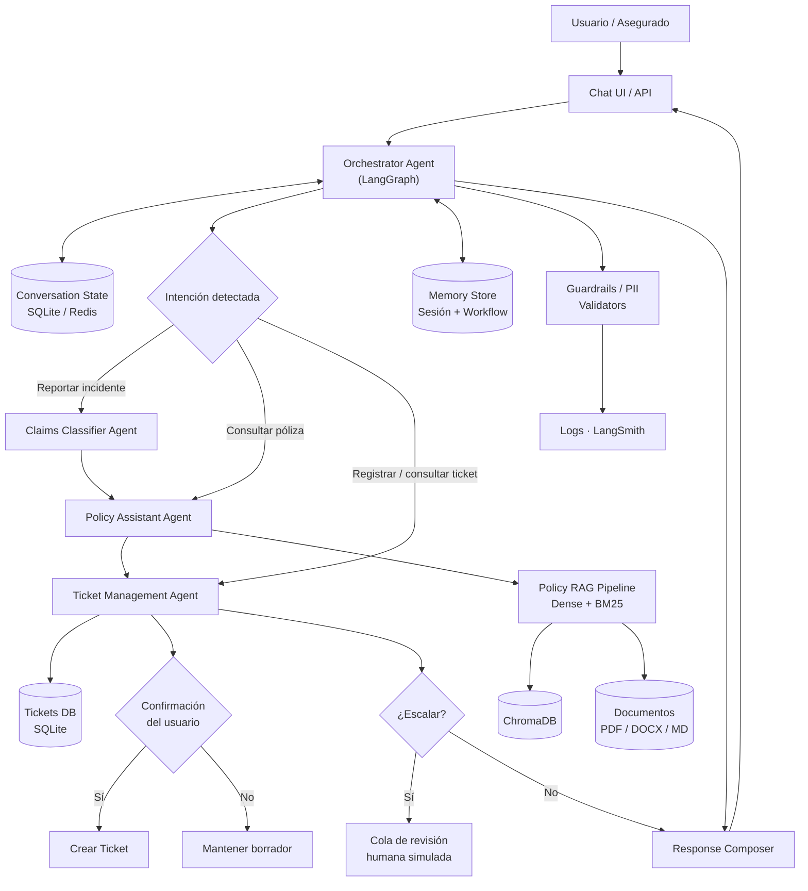
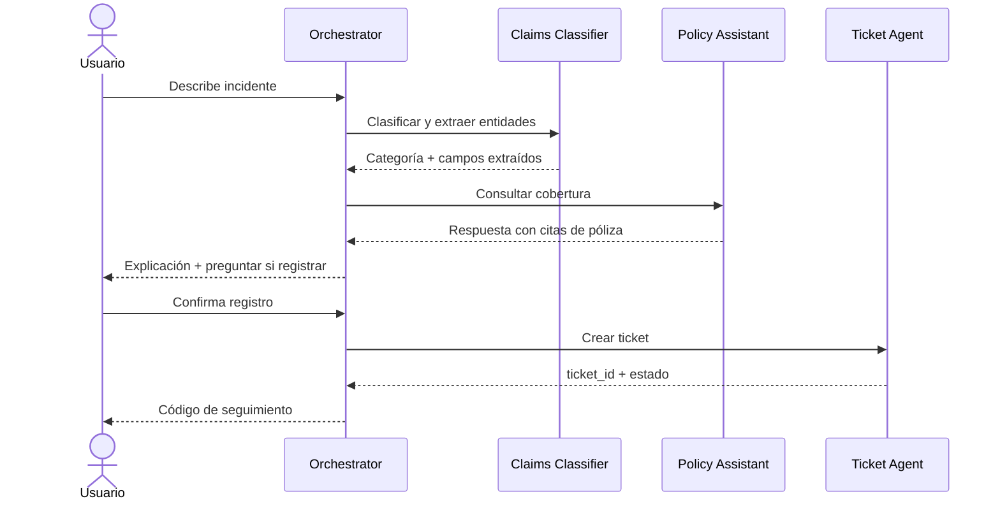

# Entregable 2 — Arquitectura del Sistema

> El diagrama completo y la descripción detallada están en  
> [`AI-ASSISTANT-INSURANCE-Agentic-RAG-Architecture.md`](../AI-ASSISTANT-INSURANCE-Agentic-RAG-Architecture.md)  
> Este documento es el entregable académico resumido.

---

## Descripción general

El sistema implementa una arquitectura **Agentic RAG multiagente** con un orquestador central (LangGraph) que enruta solicitudes a agentes especializados. Cada agente tiene acceso a herramientas Python específicas y comparten un estado de conversación persistido.

## Componentes principales

| Componente | Tecnología | Responsabilidad |
|---|---|---|
| Orchestrator Agent | LangGraph | Detecta intención, enruta y coordina el flujo |
| Claims Classifier Agent | LangChain + Pydantic | Clasifica siniestros y extrae entidades |
| Policy Assistant Agent | LangChain + ChromaDB | Responde consultas con RAG + citas |
| Ticket Management Agent | LangChain + SQLite | Crea y consulta tickets con confirmación |
| Policy RAG Pipeline | BM25 + Embeddings | Recuperación híbrida de documentos |
| Memory Store | SQLite / Redis | Estado de sesión y workflow |
| Guardrails | Presidio + validators | Seguridad de I/O |
| API | FastAPI | Capa de acceso al sistema |

## Diagrama de arquitectura

## Flujo principal

## Decisiones de diseño

- **Orquestador central** en lugar de agentes peer-to-peer sin control: permite auditar y trazar cada paso.
- **Un único RAG de pólizas** separado por metadatos: evita duplicación y facilita la evaluación.
- **SQLite para el MVP**: simple, sin infraestructura adicional; migrable a PostgreSQL en producción.
- **Confirmación explícita antes de crear tickets**: requisito de seguridad fundamental.
- **Human-in-the-loop**: casos ambiguos, alta incertidumbre o alto impacto escalan siempre.
