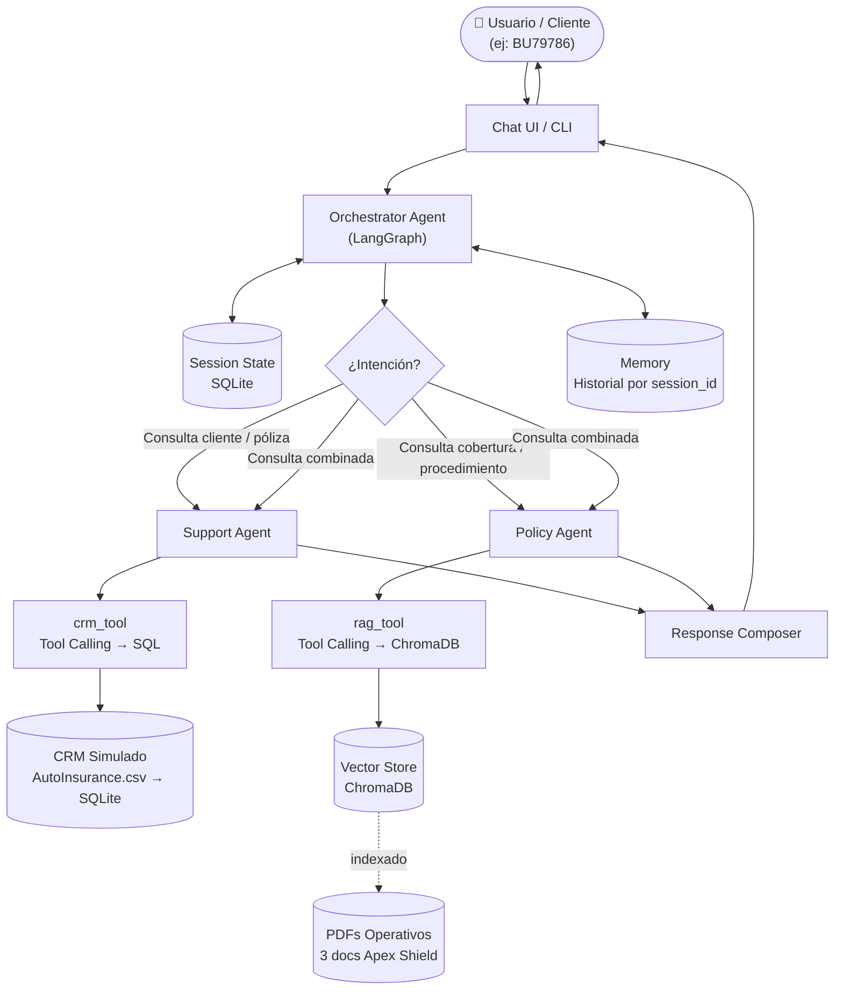
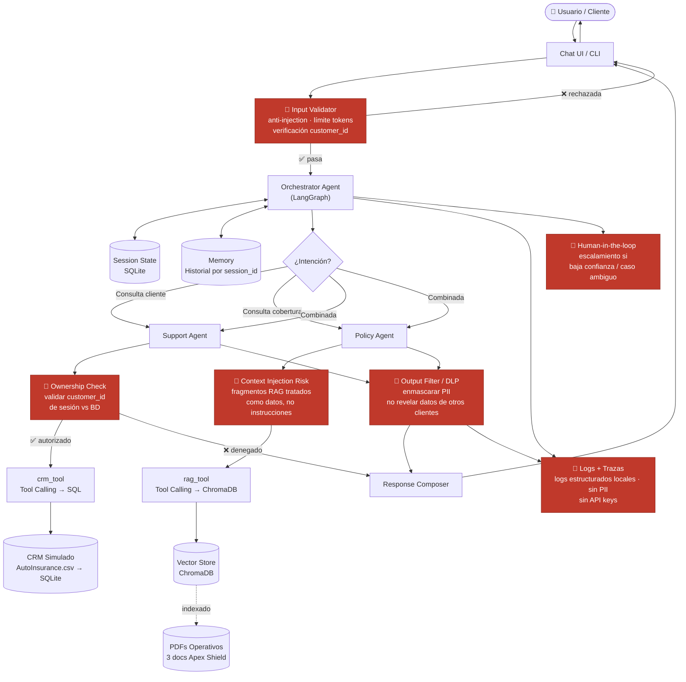

# Entregable 2: Arquitectura del Sistema

> Documento completo con diagramas y decisiones de diseño:  
> [`AI-ASSISTANT-INSURANCE-Agentic-RAG-Architecture.md`](https://github.com/Ael-Dev/AI-ASSISTANT-INSURANCE/blob/main/AI-ASSISTANT-INSURANCE-Agentic-RAG-Architecture.md)

---

## Descripción general

El sistema implementa una arquitectura **Agentic RAG** con un orquestador central (LangGraph) y dos agentes especializados, cada uno con su propia tool de acceso a datos:

| Agente | Tool | Fuente de datos |
|---|---|---|
| Support Agent | `crm_tool` | SQLite ← `AutoInsurance.csv` (CRM simulado) |
| Policy Agent | `rag_tool` | ChromaDB ← 3 PDFs operativos (RAG híbrido) |
| Orchestrator | `get_session_state` | SQLite (memoria de sesión) |

---

## Diagrama A: Arquitectura funcional

Vista limpia del sistema sin controles de seguridad. Para entender el flujo de datos.

---

## Diagrama B: Arquitectura con controles de seguridad

Misma arquitectura con los puntos de riesgo y controles marcados en **rojo**.

---

## Puntos de control de seguridad

| Nodo | Amenaza que mitiga | Módulo |
|---|---|---|
| Input Validator | Prompt injection, DoS por tokens, customer_id inválido | `src/security/validators/input_validator.py` |
| Ownership Check | Acceso a datos de otro cliente | `src/tools/crm_tool.py` |
| Context Injection Risk | Prompt injection via fragmentos RAG | `src/rag/retriever.py` + estructura de prompt |
| Output Filter / DLP | PII en respuesta, datos cruzados, alucinaciones | `src/security/guardrails/output_filter.py` |
| Logs sin PII | Privacidad en trazas y logs | `src/config/settings.py` + logs estructurados locales |
| Human-in-the-loop | Decisiones automáticas en casos ambiguos | `src/agents/orchestrator.py` |

Ver análisis completo en [`modelo-de-amenazas.md`](modelo-de-amenazas.md) y [`controles.md`](controles.md).

---

## Decisiones de diseño clave

- **Dos tools concretas** (`crm_tool` + `rag_tool`) en lugar de múltiples agentes complejos: simple, trazable y suficiente para el scope del proyecto.
- **SQLite como CRM**: el CSV de Kaggle se carga una vez. Las consultas SQL son deterministas, verificables y no dependen del LLM.
- **EnsembleRetriever**: combina búsqueda semántica (dense) + keyword (BM25) para mejor recall sin infraestructura adicional.
- **Ownership check en el backend**: la validación de pertenencia de recursos nunca la hace el LLM.
- **Separación datos/instrucciones**: fragmentos RAG siempre en sección `[CONTEXT]` delimitada, nunca mezclados con instrucciones del sistema.
