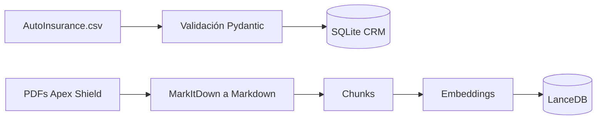
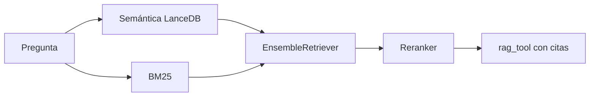

# Avance del proyecto

Estado de la implementación por etapas del plan.

| Etapa | Contenido | Estado |
|---|---|---|
| 1 Fundación | Configuración, esquemas, ingesta de CRM y base de conocimiento | Implementada en la rama feature/p1-foundation |
| 2 RAG y CRM | Retriever híbrido y rag_tool implementados. Falta CRM y memoria de sesión | En progreso |
| 3 Agentes y seguridad | Orquestador LangGraph, validadores, evaluación | Pendiente |
| 4 Integración | Prueba de punta a punta y demo | Pendiente |

## Etapa 1 Fundación

### Modelos intercambiables

Cada rol tiene su propio modelo y se cambia solo por variables de entorno. Los roles son llm, judge y embedding.

| Proveedor | Chat | Embeddings |
|---|---|---|
| ollama | Si | Si |
| openrouter | Si | Si |
| google_genai | Si | Si |
| xai | Si | No |
| anthropic | Si | No |

```bash
# Local
LLM_PROVIDER=ollama
LLM_NAME=qwen3:8b

# De pago
LLM_PROVIDER=anthropic
LLM_NAME=claude-sonnet-5-5
```

### Flujo de ingesta



### Cómo ejecutarlo

```bash
uv sync
cp .env.example .env
ollama pull bge-m3
uv run python scripts/index_documents.py
uv run pytest
```

### Resultados de la primera ejecución

| Medida | Valor |
|---|---|
| Clientes cargados en SQLite | 9133 |
| Filas descartadas por validación | 2 |
| PDFs convertidos a Markdown | 3 |
| Chunks indexados en LanceDB | 59 |
| Pruebas automáticas | 6 aprobadas |

## Etapa 2 RAG

La base vectorial es LanceDB, local y sin servidor. Todo vive en las carpetas originales del proyecto.

| Archivo | Función |
|---|---|
| src/rag/ingest.py | Chunking y carga en LanceDB |
| src/rag/retriever.py | EnsembleRetriever con búsqueda semántica y BM25 |
| src/tools/rag_tool.py | Tool que devuelve fragmentos con la fuente para citar |



Los pesos y la cantidad de fragmentos se cambian con DENSE_WEIGHT y BM25_WEIGHT. Los candidatos antes del reranking se definen con RETRIEVAL_CANDIDATES_K y los que se devuelven después con RERANK_TOP_K.

Reranker: jina-reranker-v2-base-multilingual, local, con 4 hilos de CPU para no competir con el LLM. Se eligió frente a bge-reranker-v2-m3 porque acertó igual en las pruebas y fue el doble de rápido.

Nota técnica: la librería langchain-lancedb sobrescribe el metadato source, por eso el nombre del documento se guarda como document_name.
