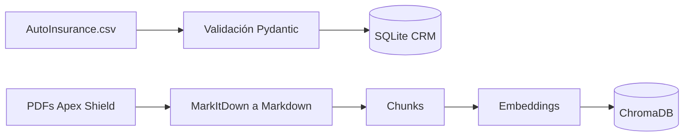

# Avance del proyecto

Estado de la implementación por etapas del plan.

| Etapa | Contenido | Estado |
|---|---|---|
| 1 Fundación | Configuración, esquemas, ingesta de CRM y base de conocimiento | Implementada en la rama feature/p1-foundation |
| 2 RAG y CRM | Retriever híbrido, tools, memoria de sesión | Pendiente |
| 3 Agentes y seguridad | Orquestador LangGraph, validadores, evaluación | Pendiente |
| 4 Integración | Prueba de punta a punta y demo | Pendiente |

## Etapa 1 Fundación

### Modelos intercambiables

Cada rol tiene su propio modelo y se cambia solo por variables de entorno. Los roles son llm, judge y embedding.

| Proveedor | Chat | Embeddings |
|---|---|---|
| ollama | Si | Si |
| openrouter | Si | Si |
| google_genai | Si | Si |
| xai | Si | No |
| anthropic | Si | No |

```bash
# Local
LLM_PROVIDER=ollama
LLM_NAME=qwen3:8b

# De pago
LLM_PROVIDER=anthropic
LLM_NAME=claude-sonnet-5-5
```

### Flujo de ingesta



### Cómo ejecutarlo

```bash
uv sync
cp .env.example .env
ollama pull bge-m3
uv run python scripts/index_documents.py
uv run pytest
```

### Resultados de la primera ejecución

| Medida | Valor |
|---|---|
| Clientes cargados en SQLite | 9133 |
| Filas descartadas por validación | 2 |
| PDFs convertidos a Markdown | 3 |
| Chunks indexados en ChromaDB | 59 |
| Pruebas automáticas | 5 aprobadas |
